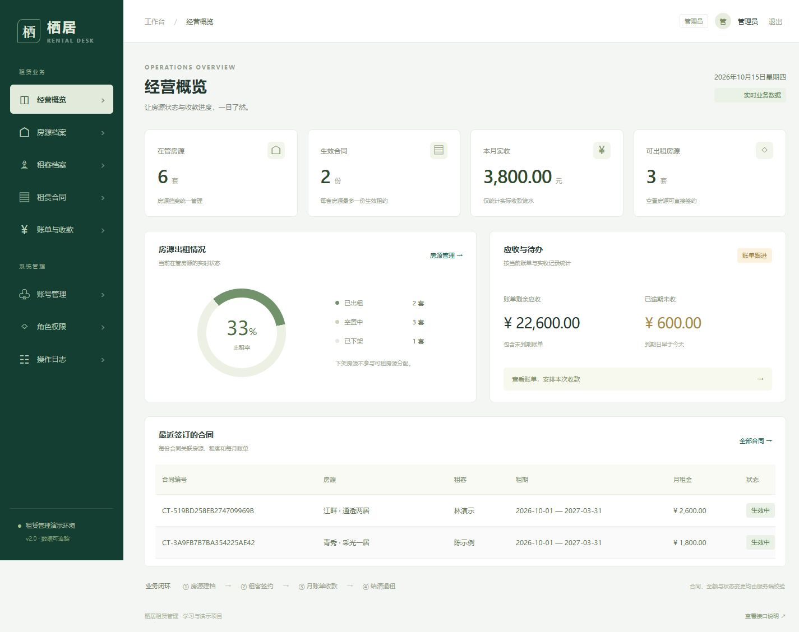

# 栖居 · rentalSys 租赁管理系统

面向 Java 后端岗位的个人学习展示项目。在原 Vue + SSM Demo 基础上，借助 AI 协作完善业务闭环、服务端约束、自动化测试与部署工具。样例均为虚构数据，项目不代表商业运营经验。

## 能做什么

- 房源与租客建档：搜索分页、表单校验、逻辑归档、房源版本冲突检测。
- 合同签订：锁定可租房源，保存租金快照，生成各月账单；数据库约束同一房源最多一份生效合同。
- 账单与收款：分次收款、超额拦截、幂等号去重、流水核对。
- 退租结算：检查到期欠款，取消未来未收账单，结束合同并释放房源。
- 账号与权限：管理员、租赁运营、只读观察员；Redis 会话、单账号单会话、禁用撤销、登录失败限流。
- 经营概览与审计：按实际数据统计出租率和收款，操作日志携带请求编号。

## 后端可讲的技术点

| 问题 | 实现 | 验证 |
| --- | --- | --- |
| 同一房源被重复出租 | 事务 + 房源行锁 + 生效房源生成列唯一索引 | 8 个并发签约请求仅 1 个成功 |
| 收款网络重试造成重复入账 | 业务幂等号唯一索引 + 合同/账单行锁 + 请求内容核对 | 4 个并发相同收款只产生 1 条流水 |
| 合同、账单、房源状态不一致 | 签约和退租分别在同一数据库事务提交 | 签约生成账单、结清退租释放房源的真实接口测试 |
| 金额精度与超额收款 | BigDecimal + DECIMAL，最多两位小数，服务端计算余额 | 金额边界单测与超额后零流水检查 |
| 前端隐藏按钮仍可绕过 | 拦截器执行方法/类权限声明 | 观察员写入与系统管理接口返回 403 |
| 旧登录凭证继续有效 | Redis Lua 原子替换、续期、撤销 | 二次登录、禁用账号及退出后旧令牌返回 401 |
| 故障难定位 | 统一错误响应、X-Request-Id、日志 MDC、审计请求编号 | 非法请求携带可关联的编号 |

上述并发数字是正确性场景规模，不是吞吐量或生产容量指标。

## 技术栈

Java 11、Spring MVC/JDBC 5.3.39、MyBatis 3.5.16、MySQL 8.4、Redis 7.4、Jedis、Druid、Bean Validation、JUnit 5、Maven；Vue 3、Element Plus、Vue Router、Vuex、Axios；Docker Compose + Tomcat 9。

保留原 SSM / WAR 技术路线以展示旧项目改造过程。没有把项目描述为 Spring Boot、微服务或分布式支付系统。前端精确依赖以 package-lock.json 为准。

## 本机启动（Windows / PowerShell 7）

先打开 Docker Desktop。本机使用已有 PowerShell 7.6.5，首次使用需从官方源准备镜像；当前这台电脑已准备完成。无需在 Windows 全局安装 JDK、Maven 或 Node。

~~~powershell
git clone https://github.com/YalaRunse/rental-sys.git
cd rental-sys
.\启动demo.ps1
.\初始化演示数据.ps1
~~~

打开 http://localhost/login ，管理员为 admin / 111111。首次示例导入会创建 6 套房源、3 位虚构租客、2 份合同、12 张账单和 2 笔收款；再次执行保留已有 DEMO- 数据。脚本登录会替换管理员会话，导入后重新登录页面即可。

~~~powershell
# 源码未变化时复用产物；强制重新安装锁定依赖并重编译：
.\启动demo.ps1 -Rebuild
# 独立数据卷中运行 Java 真实 HTTP 测试，完成后停止测试服务：
.\验证项目.ps1
# 停止展示服务，保留数据：
.\停止demo.ps1
~~~

全新电脑的镜像准备、配置、故障排查与备份见 [运维与部署](docs/运维与部署.md)。这些脚本面向 Windows PowerShell；Linux / CI 命令见 workflow。默认端口仅绑定本机，默认口令只供本机演示。

## 系统结构

~~~mermaid
flowchart LR
    Web[Vue / Element Plus] --> Static[Node 静态服务及同源代理]
    Static --> Controller[Spring MVC / 权限拦截]
    Controller --> Service[业务服务 / 事务]
    Service --> Mapper[MyBatis]
    Mapper --> DB[(MySQL / InnoDB)]
    Controller --> Session[Redis 会话 / Lua]
    Service --> Session
~~~

~~~mermaid
erDiagram
    rental_house ||--o{ rental_contract : 出租
    rental_tenant ||--o{ rental_contract : 签订
    rental_contract ||--|{ rental_bill : 按月生成
    rental_bill ||--o{ rental_payment : 分次收款
    user ||--o{ user_role : 关联
    role ||--o{ user_role : 授权
~~~

## 目录与文档

| 路径 | 用途 |
| --- | --- |
| system-admin/src/main/java/com/rental | 当前后端：api / auth / service / persistence / domain / common / config |
| system-admin/src/main/resources/db | 版本化增量 SQL，不清空旧数据 |
| system-admin/src/test/java/com/rental | 单元测试与真实接口集成测试 |
| ydl-ui/src | 当前前端 |
| deploy / tools | Compose、静态代理、构建与样例工具 |
| docs/legacy | 原 Demo 源码归档，不参与编译或路由 |
| .local-run | 本机缓存标记与备份，已忽略，不能作为发布源码 |

- [业务约定与边界](docs/需求与实现约定.md)
- [架构与技术取舍](docs/架构与技术取舍.md)
- [API 文档](docs/API.md)
- [测试报告](docs/测试报告.md)

## 已验证与尚未覆盖

2026-10-15 本机与 GitHub Actions：18 项 Java 单元测试、12 项真实接口测试全部通过；前端 npm ci 与生产构建通过。[查看本次云端验证](https://github.com/YalaRunse/rental-sys/actions/runs/38687179034)。详见测试报告及保存的证据。

当前范围是单体本机演示：没有真实支付、退款/退押工作流、按日计租、未来房源预约、合同附件、密码重置、灾备演练或大规模压测。前端仍沿用 Vue CLI，构建有组件库体积和旧工具链提示；Java 11 / Spring 5 技术基线也需在真实上线前规划升级。
