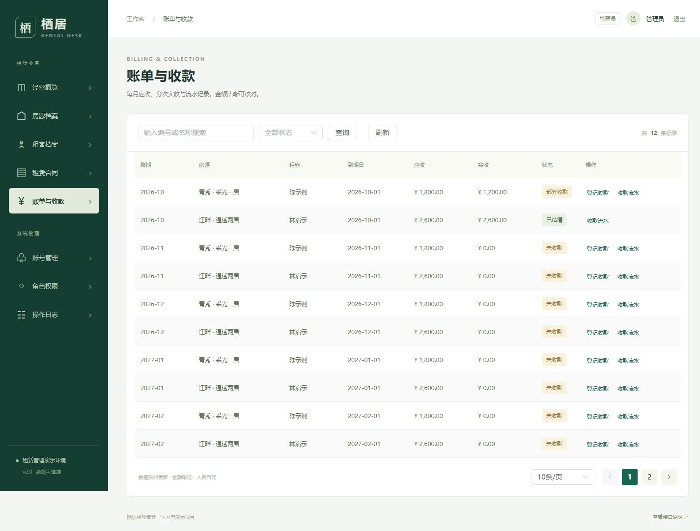

# 测试报告

验证日期：2026-10-15（Asia/Hong_Kong）。范围：当前 com.rental 后端、Vue 页面、构建与本机 Compose 部署。测试数据全部为虚构数据，接口测试使用独立 rentalsys-qa 数据库和 Redis。

## 结论与证据

| 验证项 | 实际结果 |
| --- | --- |
| Java 11 / Maven clean package | 成功，20 个主源码文件、3 个测试源码文件 |
| JUnit 单元测试 | 18 项，失败 0、错误 0、跳过 0 |
| 真实 HTTP 集成测试 | 12 项，失败 0、错误 0、跳过 0 |
| 前端全新依赖构建 | 临时 Node 22 容器中 npm ci 安装 952 个包，npm run build 成功 |
| 应用探活 | 数据库 SELECT 1 + Redis PING，HTTP 200 / UP |
| Compose 服务 | MySQL、Redis、Tomcat、前端均 healthy |
| 停止再启动 | 成功，示例业务数据保留，示例脚本再次执行跳过已有数据 |
| 数据库备份脚本 | 成功导出非空 SQL，未执行覆盖恢复 |
| PowerShell 脚本 | 语法检查通过；启动、停止、编译、测试、导入与备份实际执行 |
| 浏览器 | 下方列明的界面与身份流程通过，最终检查无 error 级控制台消息 |

本次 WAR SHA-256：E56CE809CA23DD83892526B0847283535E3CD7445C805CEAA5C6F12A58936BE7。

- [构建与依赖摘要](evidence/build-manifest.json)：WAR / 锁文件 / 前端入口散列、源码指纹、实际镜像摘要与依赖版本。
- [密码单测 XML](evidence/TEST-com.rental.PasswordHasherTest.xml)
- [规则单测 XML](evidence/TEST-com.rental.RentalRulesTest.xml)
- [接口测试 XML](evidence/TEST-com.rental.RentalApiIT.xml)
- [Failsafe 汇总](evidence/failsafe-summary.xml)
- [服务状态](evidence/compose-status.json) 与 [HTTP 冒烟](evidence/http-smoke.json)

这些文件是一次本机验证的快照；后续修改源码后需要重新执行并更新，不是持续监控结果。

## 单元测试覆盖

PasswordHasherTest：3 项，验证随机盐、匹配/错误密码、拒绝明文和损坏散列。

RentalRulesTest：15 次执行（含参数化场景），覆盖月末与闰年租期、非法月份/日期、部分和足额收款、超额/非正金额/小数精度、分页边界。

## 集成测试覆盖

通过 Java HttpClient 访问真实 Spring MVC + MySQL + Redis，不使用 Mock 代替数据库事务。

| 顺序 | 场景 | 主要断言 |
| --- | --- | --- |
| 1 | 匿名与错误密码 | 401 |
| 2 | 非法参数与追踪 | 400，返回非空 requestId；page=0、size=101 拒绝 |
| 3 | 唯一编码与旧版本编辑 | 重复编码和过期 version 返回 409 |
| 4 | 并发签约 | 8 请求同时发起，1 成功、7 冲突，生成 3 张账单 |
| 5 | 生效引用保护 | 房源/租客不能归档；欠款不能直接退租 |
| 6 | 超额收款无写入 | 409，流水数仍为 0 |
| 7 | 并发幂等收款 | 4 请求返回同一流水 ID，数据库仅 1 条；同号不同金额 409 |
| 8 | 结清与退租 | 部分余额结清后合同 CLOSED、房源 VACANT、未来 2 张账单 CANCELLED |
| 9 | 最小权限与二次登录 | 响应无 password；观察员读成功、写/管理 403；旧登录令牌 401 |
| 10 | 禁用撤销与并发登录 | 登录与禁用同时执行，禁用提交后的令牌 401；原会话及再次登录均 401 |
| 11 | 逻辑归档与审计 | 档案列表不再显示，审计数量大于 0 |
| 12 | 登录失败限制 | 前 5 次错误 401，第 6 次 429 |

准备阶段验证健康检查、登录并创建专属测试房源/租客；结束阶段验证退出成功且原令牌返回 401。测试使用随机 IT 前缀，可在保留的隔离测试卷中反复执行。

8 / 4 为并发正确性场景规模，没有测得可承诺的 QPS、吞吐或生产容量。测试也没有覆盖所有可能的线程交错。

## 浏览器验证记录

- 管理员登录成功；刷新页面从服务端恢复身份，仍可查看业务数据。
- 房源新增 → 编辑 → 保存 → 归档成功；本轮 UI-CHECK 房源已逻辑归档，未修改原个人记录。
- 房源、租客、合同、账单、账号、角色、审计、接口说明路由均能展示实际数据。
- 合同“查看账单”显示 6 条关联账单，取消合同筛选后显示全部 12 条；修复了查询参数变化未触发加载的问题。
- 流水弹窗显示已有 1200 元样例收款；中文分页正常。
- 角色页面显示管理员、运营、观察员及各自权限；管理员不能修改自身启停状态的按钮禁用。
- 退出回到登录页，再访问 dashboard 被重定向至登录页；重启服务后重新登录，6 套房源、2 份合同和 3800 元实收仍保留。
- 检查窄视口概览与桌面表格/弹窗布局，恢复浏览器默认视口并保留展示页。

## 可复现命令

~~~powershell
.\验证项目.ps1
.\启动demo.ps1
~~~

后端源码未变化时脚本复用本轮已通过单测的 WAR；强制全量重建用编译项目.ps1 -Force。前端可执行 tools/build_frontend.ps1 -Force 进行全新安装构建。

## 尚未覆盖与已知提示

没有数据库连接中断、进程崩溃、磁盘故障、锁超时/死锁重试、所有事务异常的注入验证；没有等待真实 30 分钟的会话过期测试、浏览器多品牌完整回归、恢复备份演练、真实支付或压力容量测试。

前端构建存在 Vue CLI / ESLint 旧工具链提示、Browserslist 数据陈旧提示及组件库包体积警告（vendor JS 约 1.19 MiB，CSS 约 351 KiB）。构建成功不等于完成依赖安全扫描或性能优化。

GitHub Actions 已在 2026-10-15 对提交 ecbe47769824896c29f3588d75adb2074ad18d59 完成云端验证：18 项单元测试、12 项真实 HTTP 测试以及前端 npm ci / build 全部通过。[运行记录](https://github.com/YalaRunse/rental-sys/actions/runs/38687179034)，结构化摘要见 evidence/github-actions.json。云端验证使用独立 MySQL / Redis / Tomcat，不连接本机演示库。原 Demo 的旧测试结论保留在 legacy，不能与当前接口混算。
